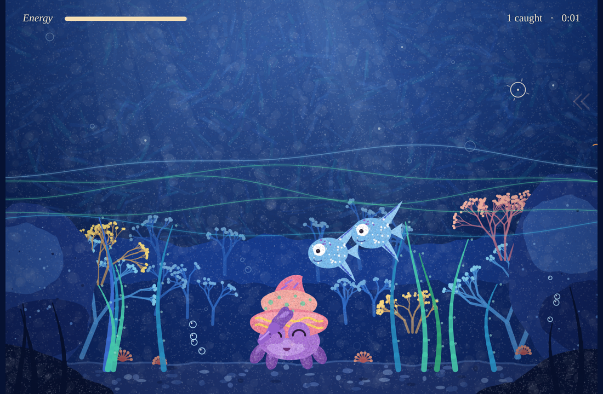

# Hermit Crab's Dinner

A one-button game set at the bottom of a blue sea. You are a small hermit crab. Reach out your long claw to catch dinner, and try not to get bitten.

## Play

- **Online (p5.js):** double-click **`Play on p5.webloc`**, or open
  https://editor.p5js.org/1214Yiran/full/r10lQasXM
- **See the code in the p5 Editor:** double-click **`Open in p5 Editor.webloc`**, or open
  https://editor.p5js.org/1214Yiran/sketches/r10lQasXM
- **Offline:** double-click **`Hermit_Crab_Game.html`**. It works without internet.

## How to play

- **Click** anywhere. The hermit crab shoots its claw to that spot and grabs any fish or shrimp it touches.
- A **fish** gives a lot of energy (little red hearts pop up). A **shrimp** gives a little.
- Energy drains all the time. When it runs out, the game is over.
- **Sharks** swim back and forth and chase your claw. Strike in the gaps between them.
- An **eel** hides in the sand with only its eyes showing. If your claw reaches over it, it bursts out and bites.
- When bitten, the crab hides in its shell, feeling sad. **Click** to make it come back out.
- Press **M** to mute or unmute the sound.

## Files

| File | What it is |
|---|---|
| `Play on p5.webloc` | Shortcut to the fullscreen game on the p5.js Web Editor. |
| `Open in p5 Editor.webloc` | Shortcut to the sketch and its code in the p5.js Web Editor. |
| `Hermit_Crab_Game.html` | Standalone offline version. It includes a small built-in drawing engine, so it doesn't need to download p5.js and keeps working without internet. |
| `p5-version/index.html`, `p5-version/sketch.js` | The p5.js version (the same code as the online sketch). Use these for GitHub or any p5.js project. |
| `preview.png` | Screenshot of the game. |

All versions run the same game code (`sketch.js`).

## Notes

- The text uses **Fraunces Light** from Google Fonts. Without internet, the offline version falls back to Georgia.
- Sound starts after the first click, because browsers require a click before playing audio. All sounds are generated in code; there are no audio files.
- The code works with both p5.js 1.x and 2.x. The online sketch runs on p5.js 2.3.4.
- To run the p5 version locally, keep `index.html` and `sketch.js` together in the same folder with these exact names.

## Editing the game

The easiest place to edit is the p5 Editor: open `Open in p5 Editor.webloc`, change the code, press ▶ to test, and **File → Save**. The links stay the same.

Numbers you can tune near the top of `sketch.js`:

- `ENERGY_SHRIMP`, `ENERGY_FISH`: energy gained from a shrimp or a fish
- `BITE_DAMAGE`: energy lost when bitten
- `MAX_REACH`: how far the claw can reach
- `TEXT_BLUE`, `TEXT_SOFT`, `TEXT_DIM`: text colors

If you change `sketch.js`, also update `p5-version/sketch.js` and the second `<script>` block in `Hermit_Crab_Game.html` so every version stays the same.

## Credits

Game design and character art direction by Yiran.
Made with p5.js. All visuals and sounds are generated in code.
