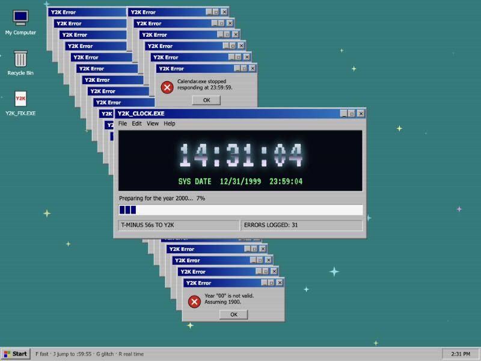
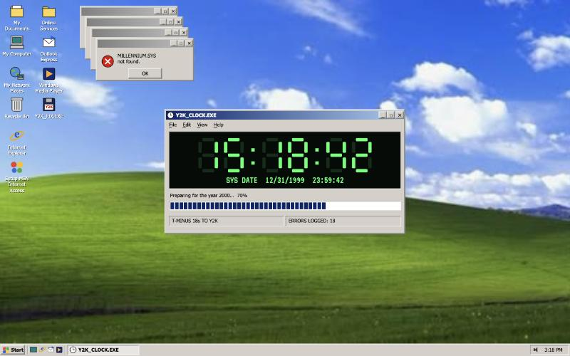
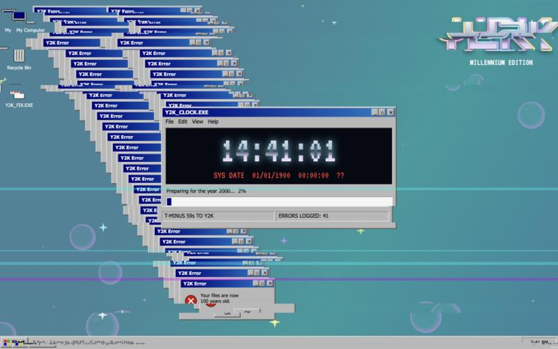
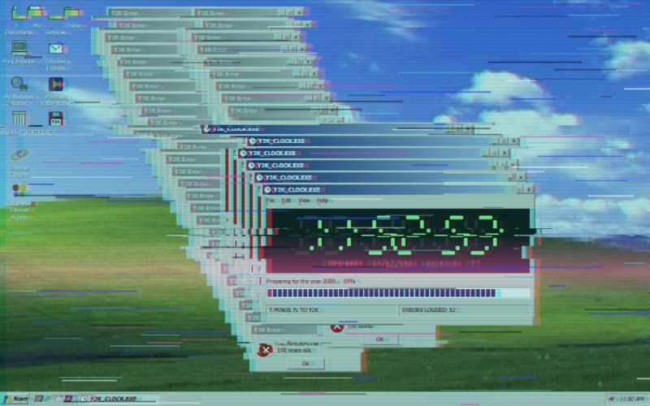
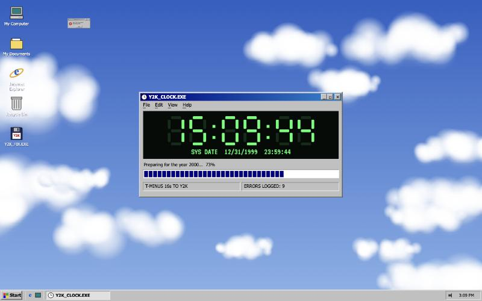
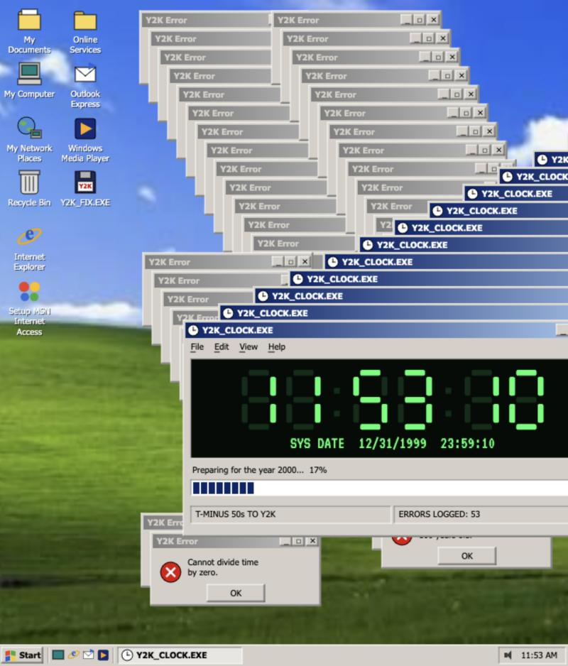
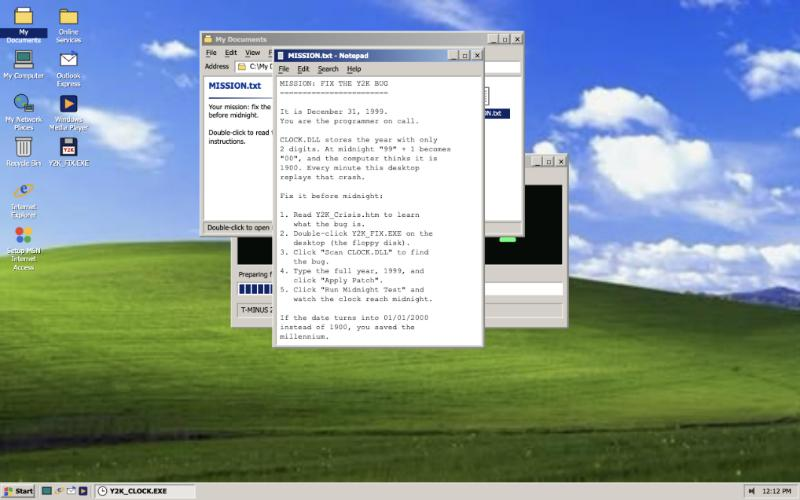
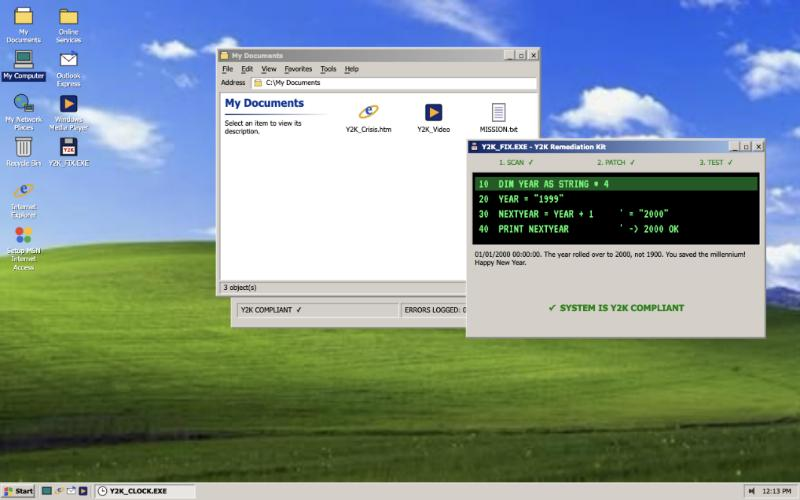
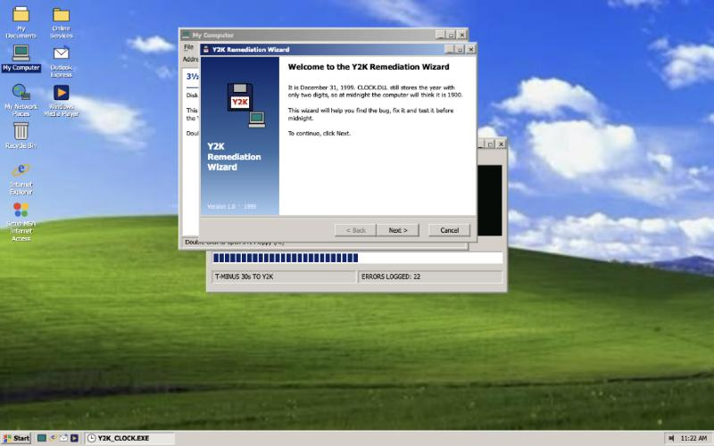
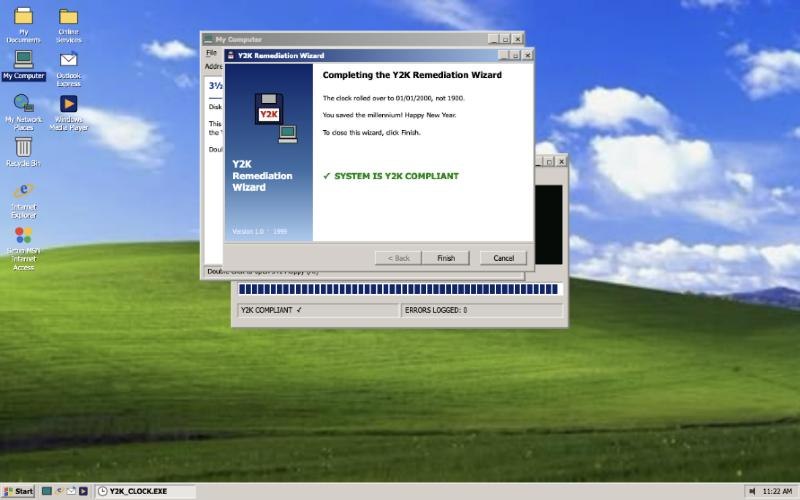

# Y2K Bug Clock

## Concept

The Y2K bug was a real timekeeping crisis in computing history. To save memory, early computers stored years as two digits (`99` meant 1999).
People feared that when 1999 rolled over to 2000, `00` would be read as **1900**, and time inside every system would "go back a hundred years."

This clock does two things at once. It **tells the real time**, and it **replays the crisis**: inside the computer, every single minute is the last minute of December 31, 1999.
At the top of each minute the system makes the Y2K mistake again, crashes, and the countdown starts over. The year 2000 never arrives, until you fix it yourself.

## How to Read the Time

| Element | What it shows |
|---|---|
| Green LCD digits and taskbar clock | The real time |
| SYS DATE | Always 12/31/1999 23:59, with the real seconds |
| "Preparing for the year 2000..." progress bar | The seconds: it fills from 0% to 100% once a minute |
| T-MINUS | Seconds left until the next "Y2K" |
| ERRORS LOGGED | The minute of the hour |
| Each new minute | The year rolls from 99 to 00 and is misread as 1900. The screen freezes and stutters, the clock window smears into a cascade of copies, and the picture breaks up like a damaged VHS tape |
| Each new hour | A bigger crash that ends on the Blue Screen of Death |

## After the First Crash

The computer never fully recovers. Before the first crash, the clock window drags cleanly. After it, the system no longer repaints behind the window, so dragging it leaves a trail of frozen copies, like a hung Windows PC. The trails stay until the end of that minute's crash.

## Play the Programmer

Double-click **My Documents** on the desktop. It holds three files. Click one to read its description in the left panel, and double-click to open it:

| File | Opens |
|---|---|
| `Y2K_Crisis.htm` | A short introduction to the Y2K crisis. Double-click for the full [Wikipedia article](https://en.wikipedia.org/wiki/Year_2000_problem) |
| `Y2K_Video` | A [video about Y2K](https://www.youtube.com/watch?v=kyZDa09U7gc) on YouTube |
| `MISSION.txt` | The instructions: you are the programmer on call on December 31, 1999 |

Then double-click **My Computer**. Next to the hard disk, the CD drive and Control Panel there is a floppy disk, **3½ Floppy (A:)**, labelled Y2K_FIX. Double-click it to start the **Y2K Remediation Wizard**, a classic millennium-era installer window with a blue banner and **< Back / Next > / Cancel** buttons. Just keep clicking Next:

1. **Scan**: a progress bar scans `CLOCK.DLL`, then shows the bug: line 10 only has room for 2 digits.
2. **Patch**: type the full year, `1999`, to make room for 4 digits.
3. **Test**: the clock runs to midnight. If the date becomes 01/01/2000 instead of 1900, the system is Y2K compliant and the crashes stop. Click Finish. Reload the page to break it again.

## Visual References

A Windows Me (Millennium Edition, 2000) desktop: the classic icons in two columns (My Documents, My Computer, Outlook Express, Windows Media Player…), the warm grey window frames, blue-to-light-blue title bars on the active window and grey ones on inactive windows, underlined menu letters, a folder window with the Windows Me "web view" panel, Notepad, a working Start menu with the vertical "Windows Me Millennium Edition" banner, Quick Launch and system tray, the hourglass cursor, and the Blue Screen of Death. The sketch runs at only 12 frames per second, so it feels like a slow PC from 2000. The time is shown with green 7-segment LCD digits, like digital clocks and media players of the era.

The wallpaper is `bliss.png`, used as-is.

## Controls

| Input | Action |
|---|---|
| Double-click an icon | Open My Documents or My Computer |
| Drag a title bar | Move a window around the desktop |
| × button | Close a window |
| Click Start | Open the Start menu. "Shut Down..." doesn't work: it is still 1999 |
| J | Jump to :59:55 of the current hour to see the big crash on the hour |
| F | Toggle 20× fast-forward |
| G | Trigger a glitch manually |
| R | Return to real time |

## Techniques Used

- `hour()` / `minute()` / `second()` to get the time
- Classes with inheritance: `AppWindow` is the shared window frame, and `FolderWindow`, `NotepadWindow` and `FixWindow` extend it
- A 7-segment display: each digit 0–9 is a list of which segments (a–g) light up
- `frameRate(12)` for a deliberately choppy, period-accurate feel
- `mousePressed()`, `doubleClicked()`, `mouseDragged()`, `keyPressed()` and hit-testing for icons, windows, buttons and typing
- `window.open()` to open the Wikipedia article and the video in a new tab
- `drawingContext` for the wallpaper image and title-bar gradients
- The glitch: held frames for a real stutter, a red/cyan channel split with `globalCompositeOperation`, a teal VHS wash, torn strips, pixelated blocks and noise streaks
- A `createGraphics()` layer that keeps the window trails between frames
- An "EASY SETTINGS" block at the top of `sketch.js` for colors, text, links and the documents
- `nf()` for leading zeros

---

# Process & Reflection

## 1. My Goal (Intent)

**My goal** was to make my original Y2K bug clock much more interactive.

**What I changed.**
- I added windows that you can drag around the desktop.
- I made the stutter (glitch) effect more realistic.
- Before, the glitch came every ten seconds. Now it follows real-life time, so the crash is part of how the clock tells time, not just a decorative effect.
- In the icons at the top left of the desktop, I added an introduction to the Y2K bug that you can click into, and an interactive process where you fix the bug yourself.

**What I kept the same.** The whole Windows interface, the look of the clock, and the logic that the screen stutters when the time reaches 00.

## 2. What I Checked (Evidence)

### Before → after

| Before | After |
|---|---|
|  First prototype: teal Windows 98 desktop, error popups that pile up (one per minute) |  Bliss wallpaper and a Windows Me interface |
|  Old glitch: a few torn strips and coloured lines, plus a chrome "Y2K" logo and bubbles that I later removed |  New glitch: frozen frames, a cascade of window copies, red/cyan colour split, teal VHS wash, blocky damage |
|  Before a crash, the window moves cleanly |  After a crash, dragging leaves trails |
|  My Documents and MISSION.txt |  First version of the fix tool, after scan → patch → test: "SYSTEM IS Y2K COMPLIANT" |
|  The fix moved into My Computer → 3½ Floppy (A:), redesigned as a millennium-era wizard |  The wizard's last page after a successful test |

More process screenshots are in the [`process/`](process/) folder (the first blue screen, the Start menu, the cloud wallpaper version).

### What was tested
- The clock matches the computer's real time.
- The glitch fires at :00 of each minute (tested live at 11:45:00).
- The J key jumps to :59:55 and the hourly crash ends on the blue screen.
- Dragging leaves no trail before the first crash, and leaves a trail after it.
- My Documents opens; clicking a file shows its description; MISSION.txt opens in Notepad.
- The full mission works: My Computer → 3½ Floppy (A:) → wizard: Next (scan) → type 1999 → Next (patch) → Next (test) → the date becomes 01/01/2000 and the crashes stop.
- No errors in the browser console.

### What I have **not** checked yet
- I did not click through the Wikipedia and YouTube links to confirm they open in every browser (they use `window.open()`, which some pop-up blockers stop).
- I only tested in Chrome on a Mac. Not tested: Safari, Firefox, Windows, phones and tablets (there is no touch support for double-click and dragging).
- The p5.js Web Editor version has not been tested with the latest code.
- That the trails clear at the end of every minute was checked in the code, not watched over a full minute.
- How the heavy glitch effect performs on a slower computer.
- Whether the flashing glitch is comfortable for people who are sensitive to flashing images.

### AI prompts and first responses

I used **Claude (Claude Code, Anthropic)** as a coding assistant. The relevant prompts, in my own words (originally in Chinese):

Prompt 1: "I want to make something with a very millennium-era feel" (我想做一个很有千禧年效果的)

**First AI response (excerpt, translated):** It listed Y2K visual elements (chrome, Windows 98 windows, progress bars, CRT scanlines, Tamagotchi) and proposed six concepts: three clocks (a *Y2K Bug Clock*, a millennium countdown, a Tamagotchi clock) and three pixel displays (desktop-icon pixels, chrome bubble pixels, Nokia LCD pixels). It recommended the **Y2K Bug Clock**, because the Y2K bug is itself a historical timekeeping problem, so the "research historical timekeeping" part of the brief becomes part of the concept rather than just decoration.

Prompt 2: "Can you try making it first?" (你可以先帮我尝试做一下吗)

**First AI response:** A first p5.js prototype: a Windows 98 window with chrome digits, a "Preparing for the year 2000..." progress bar for the seconds, one error popup per minute, and a blue screen + glitch at each minute rollover (see `process/01-first-prototype.jpg` and `process/02-first-blue-screen.jpg`).

Later prompts that changed the direction

- Use the Bliss wallpaper exactly as I provided it, and make the whole interface look like the real Windows Me, with a lower frame rate.
- Make the clock show the real time, but keep the Y2K glitch every minute: "I want it to both keep time and show the crisis."
- Make the glitch look like my reference image, with a real stuttering feel; after the glitch, dragging the clock should leave trails like my second reference image.
- Remove the error popups; clear the trails every minute; put an introduction to Y2K (Wikipedia), a video (YouTube) and simple instructions into My Documents so the user can play the programmer who fixes Y2K.

## 3. My Decisions and Credits

**My choices**
- I chose the Clock assignment and picked the Y2K Bug Clock concept from the options the AI suggested.
- I decided the clock should follow real time with a crisis every minute. I tried a version that only crashed at midnight and a 10-second loop, and rejected both.
- I asked to remove the chrome logo, bubbles and holographic effects, and to go for an authentic Windows Me desktop instead.
- I chose the visual references: the Bliss wallpaper, a Windows Me desktop screenshot, and two images of crashing Windows dialogs for the glitch and the window trails (links below).
- I asked for the low, choppy frame rate, the draggable windows, the trails that appear after a crash, and the removal of the error popups.
- I decided to add learning material (an article and a video) and to turn the fix into a short game where the viewer plays the programmer, placed inside My Computer on a floppy disk.

**How AI helped**
- I used **Claude (Claude Code, by Anthropic)** as a coding assistant. It suggested the first concepts and wrote the p5.js code based on my instructions and reference images. It also drafted the English text: the Y2K introduction, MISSION.txt, the wizard pages and this README (I wrote my goal and next question myself, in Chinese, and it translated them).
- After each change it tested the sketch in a browser and fixed bugs it found, for example popup titles that were invisible, and the clock jumping back before the glitch could show.

**Code**
- [p5.js](https://p5js.org/) 1.9.4, loaded from [cdnjs](https://cdnjs.cloudflare.com/ajax/libs/p5.js/1.9.4/p5.min.js)
- Starting point: the course examples in [areaofeffect/hello-world-week6-assignment](https://github.com/areaofeffect/hello-world-week6-assignment), especially `p5-simple-clock` (`hour()`, `minute()`, `second()`, classes, `nf()`)

**Images and fonts**
- Wallpaper `bliss.png`: "Bliss", the Windows XP default wallpaper (photo by Charles O'Rear, © Microsoft), used unchanged for a class project
- Glitch reference (cascading error dialogs): [PC Gamer, "Now that Windows is basically fine, let's remember all the times it sucked"](https://www.pcgamer.com/now-that-windows-is-basically-fine-lets-remember-all-the-times-it-sucked/)
- Window trail reference (Windows XP dialogs leaving trails over Bliss): [Yahoo Tech, "Bored? Party like it's 2001 with Windows XP"](https://www.yahoo.com/tech/bored-party-2001-windows-xp-195635057.html)
- Interface reference: a screenshot of the Windows Me desktop and Start menu
- Font: [VT323](https://fonts.google.com/specimen/VT323) from Google Fonts
- All icons and windows are drawn with p5.js code; no icon images are used.

**Content linked inside the sketch**
- [Year 2000 problem, Wikipedia](https://en.wikipedia.org/wiki/Year_2000_problem)
- [Y2K video on YouTube](https://www.youtube.com/watch?v=kyZDa09U7gc)

## 4. My Next Questions

**What still needs work**
- **Touch devices:** double-click and dragging only work with a mouse.
- **Start menu:** only "Shut Down..." does something; the other items are decoration.
- **Taskbar:** opened windows (My Documents, My Computer, Notepad, the wizard) don't get their own taskbar buttons yet.
- **The fix isn't saved:** after reloading, the bug comes back. This works as a "replay", but a visitor might expect it to stay fixed.
- **Sound:** no Windows startup/error sounds yet. I'd like to add them, but I need to find sounds I'm allowed to use.
- **Flashing:** the glitch flashes; a warning or a "reduce motion" option might be needed.

**My next question for everyone**

How does the whole experience feel to you?
