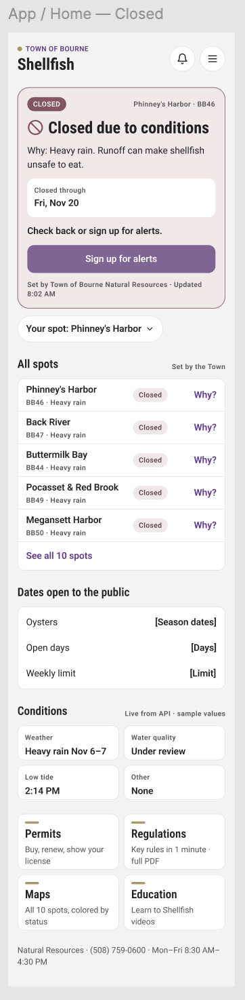
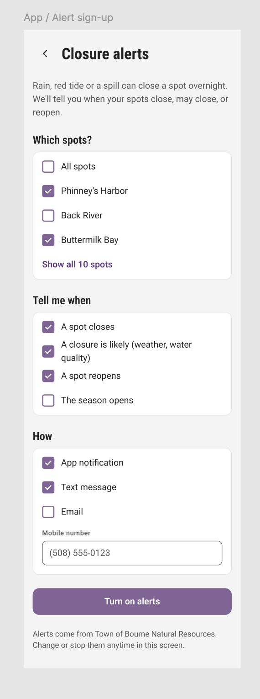
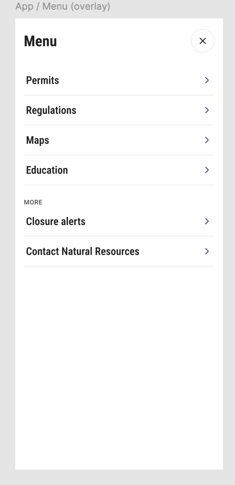
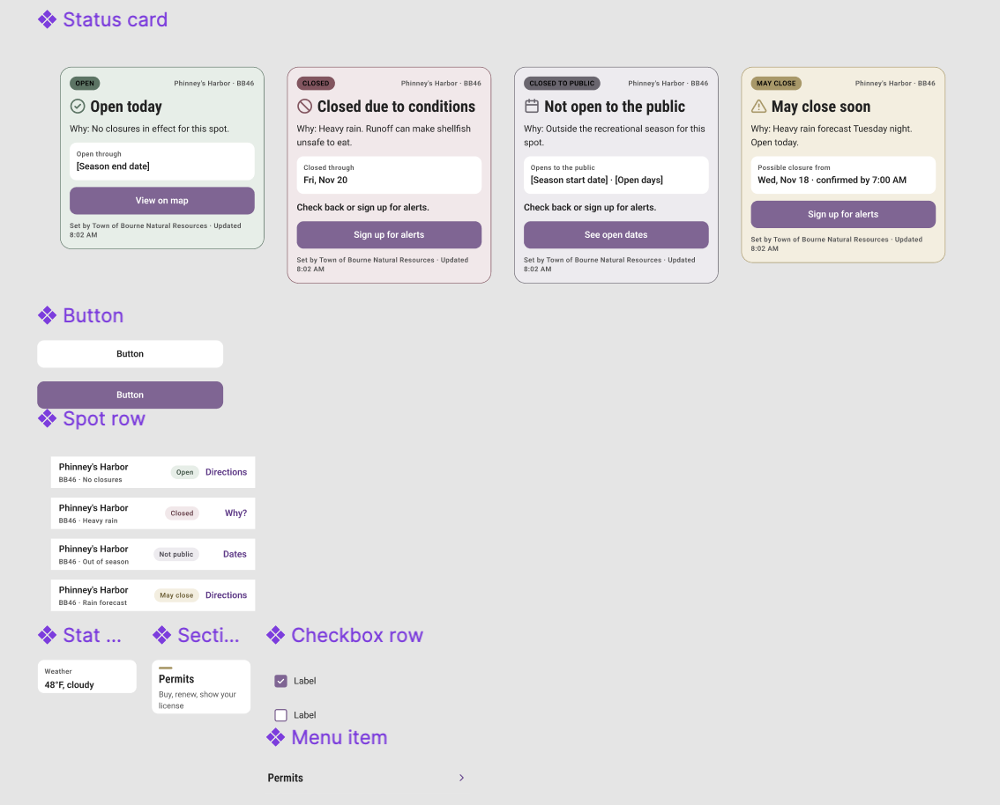

# Bourne Shellfish App — Status Card

  
  &nbsp;&nbsp;
  
  &nbsp;&nbsp;
  

  

**Figma file:** [Bourne Shellfish App — Status Card](https://www.figma.com/design/0c7xevsdlg0ijGucKJmcR7/Bourne-Shellfish-App-%E2%80%94-Status-Card?node-id=0-1)

Logic of Interaction · Week 9 · Assignment 2
By Yiran and Caitlin

---

## The problem

The Town of Bourne, Massachusetts, publishes its shellfish rules on the town website
([bourne-ma.gov/1578/Shellfish](https://www.bourne-ma.gov/1578/Shellfish)).
The information is there, but it is hard to answer the two questions a harvester actually has:

1. **Can I go out for oysters today, at my spot?**
2. **If a spot closes suddenly, how will I find out in time?**

## Our idea

We reorganized the page into a small mobile app. The answer to question 1 sits at the very top,
as one **status card**. Question 2 is answered by **closure alerts** you can sign up for.

## Screens

### Home
- **Status card** for your spot, with a spot picker under it (e.g. *Your spot: Phinney's Harbor*).
  It says what the status is, **why** (e.g. heavy rain, runoff can make shellfish unsafe to eat),
  **until when**, and what to do next.
- **All spots**: every harvesting area with its status and reason, set by the Town. Tap **Why?** for details.
- **Dates open to the public**: oyster season, open days and the weekly limit.
- **Conditions**: weather, water quality, low tide and other notes (sample values in this prototype).
- **Sections**: Permits, Regulations, Maps and Education, the rest of the original website.

### Closure alerts
Rain, red tide or a spill can close a spot overnight, so the app tells you when your spots close, may close, or reopen.
- **Which spots?** Pick your own spots, or all 10.
- **Tell me when** a spot closes, a closure is likely, a spot reopens, or the season opens.
- **How**: app notification, text message or email.
- One button: **Turn on alerts**. You can change or stop them anytime.

### Menu
- Permits, Regulations, Maps, Education.
- More: Closure alerts, Contact Natural Resources.

## Status card states

The same card changes for four situations, so a harvester can read it at a glance:

| State | Headline | Main button |
|---|---|---|
| **Open** | Open today | View on map |
| **Closed** | Closed due to conditions | Sign up for alerts |
| **Closed to public** | Not open to the public (outside the recreational season) | See open dates |
| **May close** | May close soon (e.g. heavy rain forecast) | Sign up for alerts |

Every card shows the reason, a date (open through / closed through / opens / possible closure from),
and "Set by Town of Bourne Natural Resources" with the update time.

The spot rows in the list use the same four states, each with its own action: Directions, Why? or Dates.

## Components

Built as reusable Figma components: Status card (4 states), Spot row (4 states), Button (on dark / on light),
Stat tile, Section tile, Checkbox row (on / off) and Menu item.

## Process

- We made the mind map together.
- Yiran made V1.
- Each of us made our own user flows and wireframes.
- We designed the rest together.
